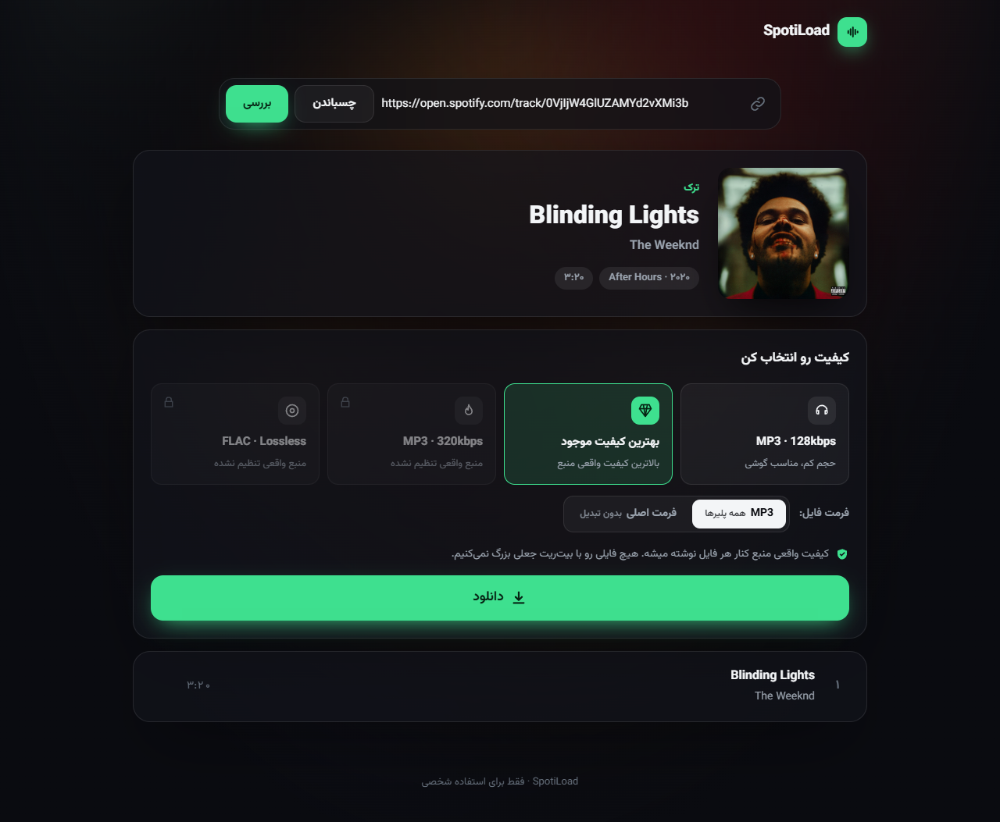
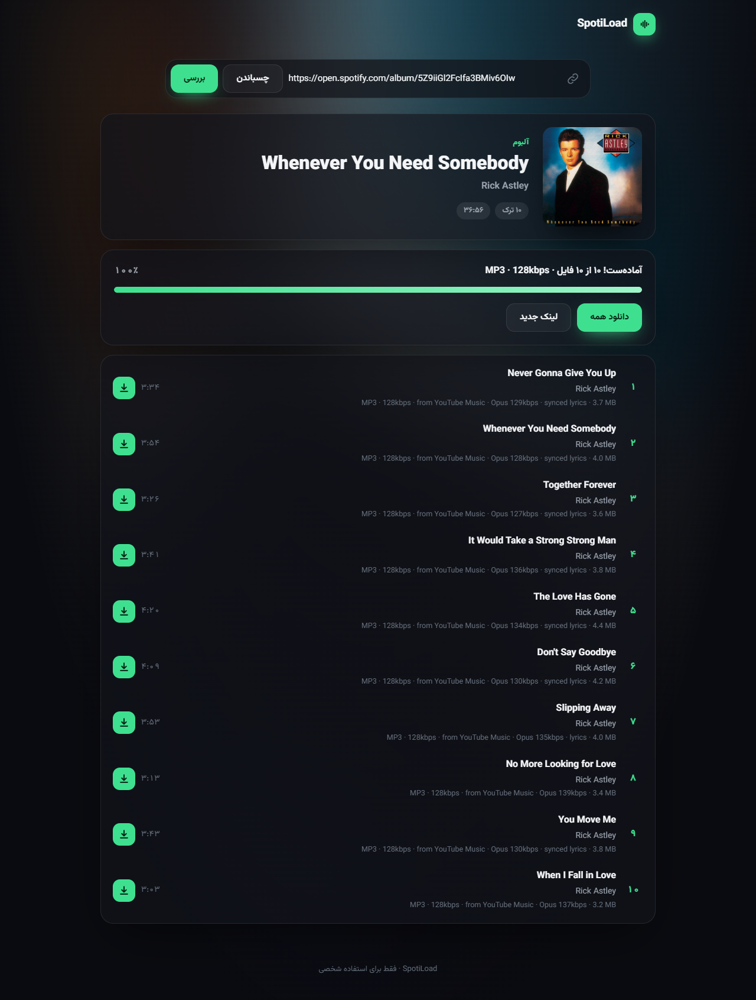
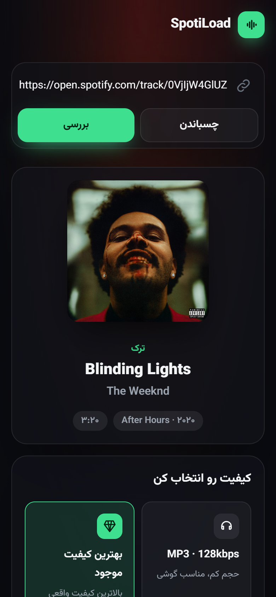
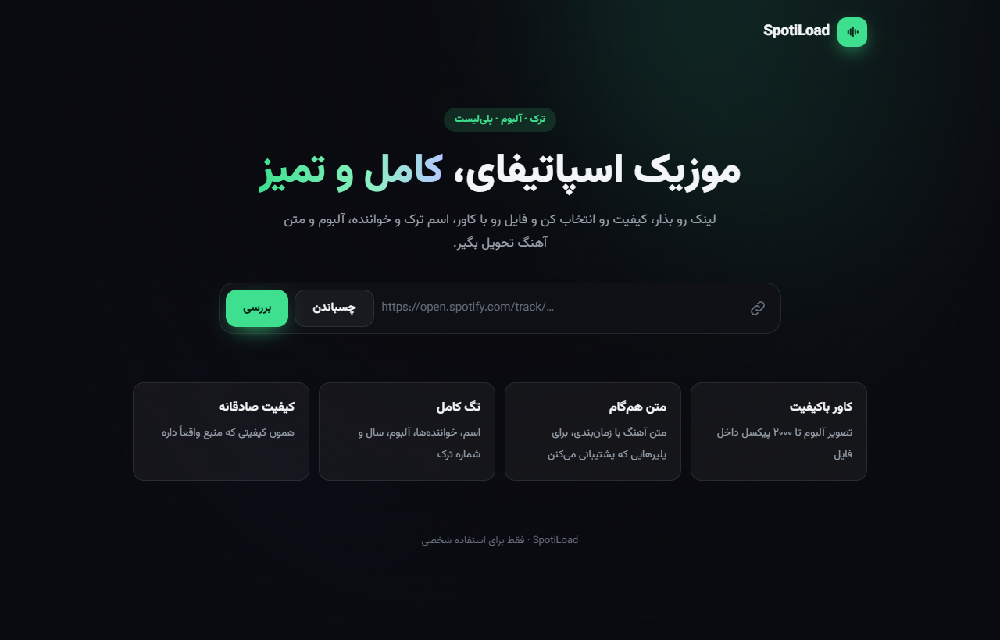
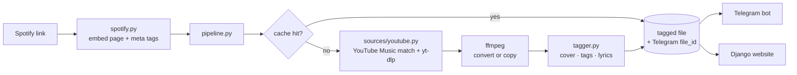

<div align="center">

# SpotiLoad

**Spotify track, album and playlist downloader: a Telegram bot and a Django website sharing one engine.**

**دانلودر ترک، آلبوم و پلی‌لیست اسپاتیفای: ربات تلگرام و سایت Django با یک موتور مشترک.**


[English](#english) · [فارسی](#فارسی)



</div>

---

## English

### What it does

Paste a Spotify link, pick a quality, get a clean audio file back with **everything** embedded in it:

- 🖼 Album art up to 2000 × 2000 px
- 🎵 Title, all artists, album, album artist
- 🔢 Track / disc number, total tracks, release date
- 📝 Lyrics from [LRCLIB](https://lrclib.net), **time-synced** when available
- 🔗 Spotify link and the real source quality, written in the file comment

It works the same in two places:

| Telegram bot | Website |
|---|---|
| Send a link → a card with the cover appears → pick a quality → files arrive in the chat. Playlists show a live progress bar with a stop button. | One page: paste a link → pick a quality → each track gets its own download button as it finishes, plus "download all". |

### Honest quality

Spotify streams are DRM-protected, so **metadata comes from Spotify and audio comes from YouTube Music**. SpotiLoad never pads a file to a bitrate the source doesn't have:

| Option | Output | Real quality |
|---|---|---|
| MP3 · 128kbps | MP3 CBR 128 | genuine |
| Best · MP3 | MP3 VBR V0 | everything the source has (Opus ~130 kbps) in MP3 form |
| Best · Original | Opus / M4A | the source file itself, no re-encoding |
| MP3 320 / FLAC | disabled | enabled automatically when a real lossless source plugin is added |

The real source quality (e.g. `YouTube Music · Opus 129kbps`) is shown next to every file.
With a YouTube **Premium** `cookies.txt` (`YT_COOKIES_FILE`) the source becomes real AAC 256 kbps.

### Screenshots

| Finished album | Mobile |
|---|---|
|  |  |



### How it works



- **No Spotify API key needed.** Since February 2026 the Spotify Web API requires a Premium account, so metadata is read from Spotify's public embed player and link-preview meta tags.
- **Smart matching.** YouTube Music results are scored on title, artists, duration and album, with penalties for live, remix, cover and sped-up versions.
- **Cache.** Every (track, quality) is built once and shared by the bot and the site. The bot also remembers Telegram's `file_id`, so a track sent before is re-sent instantly.
- **Resilient.** It retries YouTube 403s and LRCLIB outages, and runs a limited number of downloads in parallel.

### Project layout

```
core/            shared engine
  spotify.py       Spotify metadata without the API
  sources/         audio source plugins (YouTube Music)
  pipeline.py      download → convert → tag → cache
  tagger.py        MP3 / M4A / Opus / FLAC tags
  lyrics.py        LRCLIB lyrics
  cache.py         SQLite file + Telegram file_id cache
bot/             Telegram bot (python-telegram-bot)
web/             Django website (vanilla JS, RTL Persian UI)
run_bot.py       bot entry point
```

### Setup

Requirements: **Python 3.11+** and **ffmpeg** on `PATH`. Deno, which yt-dlp needs to solve YouTube's JS challenges, is installed by pip.

```bash
git clone https://github.com/Amirrezaaaaaa/SpotiLoad.git
cd SpotiLoad
python -m venv .venv
.venv/Scripts/pip install -r requirements.txt   # Linux/macOS: .venv/bin/pip
cp .env.example .env                            # then put your bot token in .env
```

Run the bot:

```bash
.venv/Scripts/python run_bot.py
```

Run the website at http://127.0.0.1:8000:

```bash
.venv/Scripts/python web/manage.py migrate
.venv/Scripts/python web/manage.py runserver
```

### Configuration (`.env`)

| Variable | Description |
|---|---|
| `TELEGRAM_BOT_TOKEN` | Token from [@BotFather](https://t.me/BotFather) |
| `TELEGRAM_BOT_USERNAME` | Shown as a "Telegram bot" link on the website |
| `TELEGRAM_API_URL` | Optional local Bot API server (raises the upload limit from 50 MB to 2 GB) |
| `PROXY_URL` | Optional `socks5://` or `http://` proxy for every outgoing request |
| `MAX_CONCURRENT_DOWNLOADS` | Parallel downloads (default 3) |
| `LYRICS_ENABLED` / `LYRICS_STYLE` | Embed lyrics; `synced` (LRC) or `plain` |
| `KEEP_FILES_DAYS` | Delete local files unused for N days (0 = keep) |
| `YT_COOKIES_FILE` | Optional YouTube Premium cookies for AAC 256 kbps |
| `DJANGO_SECRET_KEY`, `DJANGO_DEBUG`, `DJANGO_ALLOWED_HOSTS` | Usual Django settings |

### Adding a lossless source

Subclass `AudioSource` in `core/sources/base.py`, declare its `tiers` (`lossy`, `mp3_320`, `lossless`) and register it in `core/sources/__init__.py`. The 320 and FLAC options then turn on in both the bot and the website, with no other changes.

### Limitations

- Only the first **100 tracks** of a playlist can be read (a limit of Spotify's embed player).
- The public Telegram Bot API caps uploads at 50 MB.

### Disclaimer

For personal and educational use only. Respect copyright and the terms of service of Spotify and YouTube.

---

<div dir="rtl">

## فارسی

### چی کار می‌کنه؟

لینک اسپاتیفای رو بده، کیفیت رو انتخاب کن و یه فایل تمیز تحویل بگیر که **همه‌چیز** داخلشه:

- 🖼 کاور آلبوم تا ۲۰۰۰×۲۰۰۰ پیکسل
- 🎵 اسم ترک، همه خواننده‌ها، آلبوم و خواننده آلبوم
- 🔢 شماره ترک و دیسک، تعداد ترک‌ها و تاریخ انتشار
- 📝 متن آهنگ از [LRCLIB](https://lrclib.net)، **هم‌گام** اگه موجود باشه
- 🔗 لینک اسپاتیفای و کیفیت واقعی منبع، داخل کامنت فایل

دو جا کار می‌کنه:

- **ربات تلگرام:** لینک رو بفرست، یه کارت با کاور میاد، کیفیت رو انتخاب کن و فایل‌ها توی چت میان. برای پلی‌لیست نوار پیشرفت زنده و دکمه توقف داره.
- **سایت:** یه صفحه است. لینک رو بذار و کیفیت رو انتخاب کن. هر ترک که آماده بشه دکمه دانلود خودش رو می‌گیره، و دکمه «دانلود همه» هم هست.

### کیفیت صادقانه

صدای اسپاتیفای رمزگذاری‌شده (DRM) پخش میشه؛ برای همین **اطلاعات ترک از اسپاتیفای و خود صدا از YouTube Music** میاد. هیچ فایلی رو با بیت‌ریت جعلی بزرگ نمی‌کنیم:

| گزینه | خروجی | کیفیت واقعی |
|---|---|---|
| MP3 · 128kbps | MP3 CBR 128 | واقعی |
| بهترین · MP3 | MP3 VBR V0 | همون کیفیت منبع (Opus حدود ۱۳۰kbps) در قالب MP3 |
| بهترین · فرمت اصلی | Opus یا M4A | خود فایل منبع، بدون هیچ تبدیلی |
| 320 و FLAC | غیرفعال | با اضافه شدن یه منبع lossless واقعی خودکار فعال میشن |

کیفیت واقعی منبع (مثلاً `YouTube Music · Opus 129kbps`) کنار هر فایل نوشته میشه.
با `cookies.txt` یه اکانت YouTube Premium در `YT_COOKIES_FILE`، منبع به AAC 256kbps واقعی می‌رسه.

### نکته‌های فنی

- **بدون کلید API اسپاتیفای:** از فوریه ۲۰۲۶ Web API اسپاتیفای اکانت Premium می‌خواد؛ برای همین اطلاعات از پلیر embed عمومی و متاتگ‌های اسپاتیفای خونده میشه.
- **تطبیق هوشمند:** نتیجه‌های YouTube Music بر اساس اسم، خواننده، مدت و آلبوم امتیاز می‌گیرن. نسخه‌های live، ریمیکس، کاور و sped-up جریمه میشن.
- **کش:** هر ترک با هر کیفیت فقط یک بار ساخته میشه و بین ربات و سایت مشترکه. ربات `file_id` تلگرام رو هم نگه می‌داره، پس ترکی که قبلاً فرستاده شده فوری دوباره ارسال میشه.
- **پایداری:** خطای ۴۰۳ یوتیوب و قطعی LRCLIB خودکار دوباره امتحان میشن و تعداد دانلودهای هم‌زمان محدوده.

### راه‌اندازی

پیش‌نیاز: **Python 3.11** یا جدیدتر و **ffmpeg** روی PATH. Deno که yt-dlp برای حل چالش‌های جاوااسکریپتی یوتیوب لازم داره، با pip نصب میشه.

```bash
git clone https://github.com/Amirrezaaaaaa/SpotiLoad.git
cd SpotiLoad
python -m venv .venv
.venv/Scripts/pip install -r requirements.txt
cp .env.example .env
```

بعد `.env` رو باز کن و `TELEGRAM_BOT_TOKEN` رو بذار. اگه به پروکسی نیاز داری، `PROXY_URL` رو هم تنظیم کن.

اجرای ربات:

```bash
.venv/Scripts/python run_bot.py
```

اجرای سایت روی http://127.0.0.1:8000:

```bash
.venv/Scripts/python web/manage.py migrate
.venv/Scripts/python web/manage.py runserver
```

### اضافه کردن منبع lossless

یه کلاس از `AudioSource` در `core/sources/base.py` بساز، `tiers` رو مشخص کن (`lossy`، `mp3_320` یا `lossless`) و توی `core/sources/__init__.py` ثبتش کن. گزینه‌های 320 و FLAC بدون هیچ تغییر دیگه‌ای هم در ربات و هم در سایت فعال میشن.

### محدودیت‌ها

- از هر پلی‌لیست فقط **۱۰۰ ترک اول** خونده میشه (محدودیت پلیر embed اسپاتیفای).
- سقف آپلود Bot API عمومی تلگرام ۵۰ مگابایته؛ با سرور محلی Bot API (`TELEGRAM_API_URL`) تا ۲ گیگ میشه.

### سلب مسئولیت

فقط برای استفاده شخصی و آموزشی. به حق نشر و قوانین اسپاتیفای و یوتیوب احترام بذارید.

</div>

---

<div align="center">

MIT License · Font: [Vazirmatn](https://github.com/rastikerdar/vazirmatn) (OFL)

</div>
